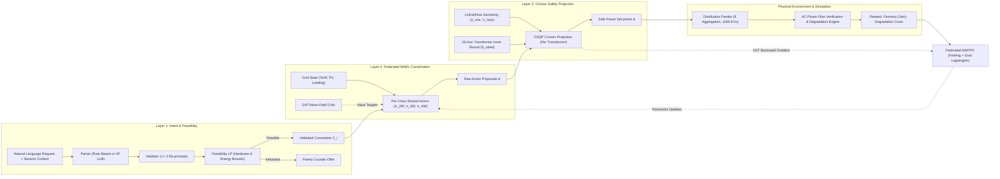

# SOLACE: Solver-Grounded, LLM-Assisted Coordination of Electric Vehicles

[](https://github.com/Himanshu3122/Constrained-Multi-Agent-RL-for-Charging-a-Mixed-2W-3W-4W-EV-Fleet-on-a-Weak-Low-Voltage-Network/actions)
[](https://www.python.org/)
[](LICENSE)
[](https://github.com/astral-sh/ruff)

> Research implementation of *"Solver-Grounded, LLM-Orchestrated Multi-Agent Reinforcement Learning for Fair and Degradation-Aware EV Charging and V2G in Weak Distribution Networks with 2W/3W-Dominated Fleets"*.

---

> [!IMPORTANT]
> **Research Scope & Numerical Results Disclaimer**
> 
> The manuscript's reported numerical tables are **illustrative target figures, not empirical measurements** (as explicitly stated in the paper source). This repository provides the complete, verifiable scientific method, mathematical formulations, simulation environment, and software execution protocol. 
> 
> The software ships **no pretrained neural network weights** and operates on **synthetic data pipelines by default** unless external datasets are supplied. For full implementation boundaries and engineering assumptions (A1–A19), see [IMPLEMENTATION_STATUS.md](IMPLEMENTATION_STATUS.md) and [docs/assumptions.md](docs/assumptions.md).

---

## Table of Contents

- [Motivation & Problem Context](#motivation--problem-context)
- [Three-Layer Separation of Authority](#three-layer-separation-of-authority)
- [System Architecture](#system-architecture)
- [Key Technical Contributions](#key-technical-contributions)
- [Repository Structure](#repository-structure)
- [Installation & Environment Setup](#installation--environment-setup)
  - [Prerequisites](#prerequisites)
  - [Standard Installation](#standard-installation)
  - [Fast Alternative Installation via uv](#fast-alternative-installation-via-uv)
  - [Optional LLM Support](#optional-llm-support)
  - [Verifying Installation](#verifying-installation)
- [Quick Start](#quick-start)
- [Execution Pipeline](#execution-pipeline)
  - [1. Data Preprocessing](#1-data-preprocessing)
  - [2. Policy Training](#2-policy-training)
  - [3. Multi-Seed Evaluation & Reporting](#3-multi-seed-evaluation--reporting)
  - [4. Command-Line Inference](#4-command-line-inference)
  - [5. Production REST API Serving](#5-production-rest-api-serving)
- [Baselines & Ablation Studies](#baselines--ablation-studies)
- [Data Contracts & Custom Feeder Inputs](#data-contracts--custom-feeder-inputs)
- [Reproducibility & Scientific Boundaries](#reproducibility--scientific-boundaries)
- [Development, Linting & Testing](#development-linting--testing)
- [Troubleshooting & FAQ](#troubleshooting--faq)
- [Citation](#citation)
- [License & Governance](#license--governance)

---

## Motivation & Problem Context

In emerging economies and weak radial distribution systems (notably in South Asia), rapid electric vehicle adoption is heavily dominated by two-wheelers (2W) and three-wheelers (3W) alongside passenger four-wheelers (4W). These vehicles exhibit idiosyncratic usage patterns: short, irregular charging sessions that concentrate on residential evening peak hours, feeding into distribution transformers originally sized solely for basic lighting and household loads.

Coordinating mixed-fleet charging and Vehicle-to-Grid (V2G) flexibility introduces three fundamental dilemmas:
1. **Unstructured Driver Intent**: Drivers communicate requirements in conversational language (e.g., *"Need 80% by 7 AM, allow discharge up to 3 kWh but stay above 40%"*). While Large Language Models (LLMs) can parse conversational text, LLMs fail at physical constraint satisfaction and produce ungrounded, infeasible power schedules.
2. **Scalable Coordination**: Centralized optimization scales poorly across hundreds of concurrent EVs across multiple distribution transformers. Multi-Agent Reinforcement Learning (MARL) coordinates high-dimensional fleets, but standard unconstrained MARL routinely violates grid voltage and transformer thermal thresholds.
3. **Hardware & Feeder Safety**: Neural network policies cannot provide hard, deterministic safety guarantees. Set-points dispatched to real infrastructure must be guaranteed to lie within voltage and transformer limits at all times.

---

## Three-Layer Separation of Authority

SOLACE resolves these challenges by strictly isolating responsibilities across three decoupled layers:

| Architectural Layer | Implementation Module | What It Produces | What It Is Prohibited from Producing |
|---|---|---|---|
| **Layer 1: Intent Pipeline** | [`solace.intent`](src/solace/intent/) | Typed, schema-validated, LP-feasibility-checked charging constraints $\mathcal{C}_i$ | Power set-points dispatched to chargers |
| **Layer 2: Coordination** | [`solace.training`](src/solace/training/), [`solace.agents`](src/solace/agents/) | Decentralized raw action proposals $\tilde{a}_i \in [-1, 1]$ via class-specific actors | Hardware-executable charging commands |
| **Layer 3: Safety Projection** | [`solace.safety`](src/solace/safety/) | Verified set-points $\hat{a}_i$ projected onto LinDistFlow voltage & 16-gon capacity bounds | Policy updates or driver concessions |

---

## System Architecture



Detailed architectural specifications, equations, and mathematical derivations are available in [docs/architecture.md](docs/architecture.md).

---

## Key Technical Contributions

- **Layer 1 Intent Pipeline ([`solace.intent`](src/solace/intent/))**:
  - Pydantic schema validation for charging targets, deadlines, and V2G willingness ([`schema.py`](src/solace/intent/schema.py)).
  - Up to two automated retry validations with deterministic fallback constraints and operator notification flagging ([`validator.py`](src/solace/intent/validator.py), [`pipeline.py`](src/solace/intent/pipeline.py)).
  - Linear Programming (LP) feasibility verification checking battery energy balance and charger power ratings ([`feasibility.py`](src/solace/intent/feasibility.py)).
- **Layer 2 Federated Constrained MAPPO ([`solace.training`](src/solace/training/), [`solace.agents`](src/solace/agents/))**:
  - Class-specific parameter sharing across actors ($\pi_{2\text{W}}$, $\pi_{3\text{W}}$, $\pi_{4\text{W}}$) handling heterogeneous dynamics ([`networks.py`](src/solace/agents/networks.py)).
  - Centralized graph-attention (GAT) mean-field critic conditioning value estimates on feeder topology ([`networks.py`](src/solace/agents/networks.py)).
  - Dual Lagrangian ascent updates to enforce battery degradation cost budgets and Jain fairness index targets ([`mappo.py`](src/solace/training/mappo.py)).
  - Federated Averaging (FedAvg) across 8 aggregator sub-networks ([`federated.py`](src/solace/training/federated.py)).
- **Layer 3 Differentiable Convex Safety Projection ([`solace.safety`](src/solace/safety/))**:
  - Solves a convex Quadratic Program (QP) per transformer via OSQP ([`projection.py`](src/solace/safety/projection.py)).
  - Enforces transformer kVA thermal limits using a 16-sided conservative inner polygon approximation of the circle.
  - Enforces substation node voltage boundaries ($[0.95, 1.05]\,\text{p.u.}$) via LinDistFlow sensitivity matrices.
  - Provides analytical active-set KKT gradients for end-to-end backpropagation through the QP projection.
- **Physical Feeder & Fleet Simulation ([`solace.grid`](src/solace/grid/), [`solace.degradation.py`](src/solace/degradation.py), [`solace.env`](src/solace/env/))**:
  - Radial distribution network modeling with exact AC power flow validation ([`powerflow.py`](src/solace/grid/powerflow.py)).
  - Semi-empirical lithium-ion battery degradation modeling accounting for SEI layer growth and mechanical stress fatigue ([`degradation.py`](src/solace/degradation.py)).
  - Multi-agent gym environment coordinating dynamic arrival/departure queues ([`charging_env.py`](src/solace/env/charging_env.py)).

---

## Repository Structure

```text
├── configs/                      # Validated YAML experiment configurations
│   ├── ablations/                # 6 ablation study setups (centralized, no-projection, etc.)
│   ├── baselines/                # Comparative baselines (mappo.yaml, ippo.yaml)
│   ├── default.yaml              # Full paper configuration (1,000 EVs, 8 aggregators)
│   ├── smoke.yaml                # Lightweight configuration for smoke tests & CI
│   └── study*.yaml               # Parametric research studies
├── data/                         # Data directory (synthetic by default; external loaders)
│   └── README.md                 # Dataset specifications & ingestion schemas
├── docs/                         # In-depth technical documentation
│   ├── architecture.md           # Theoretical derivation & mathematical formulations
│   ├── assumptions.md            # Catalogue of engineering assumptions (A1–A19)
│   ├── deployment.md             # Docker containerization & production deployment
│   ├── evaluation.md             # Metric definitions & multi-seed statistical analysis
│   ├── inference.md              # CLI & programmatic inference guide
│   ├── paper_implementation_mapping.md # Section-by-section paper-to-code trace
│   ├── reproducibility.md        # Deterministic reproduction protocol & limitations
│   ├── setup.md                  # Detailed environment installation instructions
│   ├── training.md               # Training pipeline, loss formulation & hyperparameters
│   └── troubleshooting.md        # Common failure modes & resolutions
├── scripts/                      # Executable CLI workflows & research tools
│   ├── preprocess.py             # Scenario generator (fleet, loads, solar, splits)
│   ├── train.py                  # Federated training entry-point
│   ├── evaluate.py               # Evaluation runner across 9 KPI metrics
│   ├── infer.py                  # Single-request intent & dispatch inference CLI
│   ├── smoke_test.py             # End-to-end software pipeline verification script
│   ├── intent_corpus.py          # Synthetic natural language corpus generator
│   └── finetune_intent_lora.py   # Intent LLM LoRA fine-tuning script
├── src/solace/                   # Core Python package
│   ├── agents/                   # Neural network architectures (actors & GAT critic)
│   ├── api/                      # FastAPI deployment service (/health, /v1/intent, /v1/dispatch)
│   ├── baselines/                # Uncontrolled, ToU, Thompson Bandits, Horizon QP
│   ├── data/                     # Fleet generators, session managers, load profiles
│   ├── env/                      # Multi-agent Gymnasium-compatible ChargingEnv
│   ├── evaluation/               # Statistical aggregation & markdown report generator
│   ├── grid/                     # Radial feeder models, LinDistFlow, AC power flow
│   ├── intent/                   # Pydantic schemas, regex/LLM parsers, LP feasibility
│   ├── safety/                   # OSQP projection & analytical KKT gradients
│   ├── training/                 # MAPPO, FedAvg aggregator, rollout buffers, checkpoints
│   ├── utils/                    # Deterministic seeding, logging, run directories
│   ├── config.py                 # Pydantic configuration parser with YAML inheritance
│   └── degradation.py            # Battery SEI growth & mechanical fatigue models
├── tests/                        # Comprehensive test suite
│   ├── unit/                     # Component-level tests (grid, safety, intent, env)
│   ├── integration/              # Pipeline tests (training, evaluation, API)
│   └── smoke/                    # Test invocation for smoke scripts
├── Dockerfile                    # Production container image
├── Makefile                      # Standardized automation targets
└── pyproject.toml                # Build system & package specifications
```

---

## Installation & Environment Setup

### Prerequisites

- **Python**: `3.10`, `3.11`, `3.12`, or `3.13` (Python 3.14+ is not supported due to PyTorch wheel constraints).
- **Operating System**: Linux, macOS, or Windows (x86_64 or arm64).

### Standard Installation

```bash
# 1. Clone repository
git clone https://github.com/Himanshu3122/Constrained-Multi-Agent-RL-for-Charging-a-Mixed-2W-3W-4W-EV-Fleet-on-a-Weak-Low-Voltage-Network.git
cd Constrained-Multi-Agent-RL-for-Charging-a-Mixed-2W-3W-4W-EV-Fleet-on-a-Weak-Low-Voltage-Network

# 2. Create and activate a virtual environment
# On Linux/macOS:
python3 -m venv .venv
source .venv/bin/activate

# On Windows (PowerShell):
python -m venv .venv
.venv\Scripts\Activate.ps1

# 3. Install CPU-only PyTorch (avoids multi-gigabyte CUDA downloads on CPU systems)
pip install torch --index-url https://download.pytorch.org/whl/cpu

# 4. Install solace in editable mode with development dependencies
pip install -e ".[dev]"
```

> [!TIP]
> If training on a CUDA-capable GPU, install the standard PyTorch CUDA build instead: `pip install torch --index-url https://download.pytorch.org/whl/cu121`.

### Fast Alternative Installation via uv

If you have [uv](https://github.com/astral-sh/uv) installed, setup is significantly faster:

```bash
uv venv --python 3.12 .venv
# On Linux/macOS:
source .venv/bin/activate
# On Windows:
.venv\Scripts\Activate.ps1

uv pip install torch --index-url https://download.pytorch.org/whl/cpu
uv pip install -e ".[dev]"
```

### Optional LLM Support

To execute the HuggingFace-based LLM parser (`HFParser`) or run LoRA fine-tuning scripts, install the optional LLM dependency bundle:

```bash
pip install -e ".[llm]"
```

This installs `transformers>=4.43`, `peft>=0.11`, and `accelerate>=0.30`. Running Llama-3.1-8B-Instruct requires a HuggingFace account and token (`export HF_TOKEN=...`).

### Verifying Installation

Verify that the package and its native solvers are properly linked:

```bash
python -c "import solace; print(f'SOLACE version: {solace.__version__}')"
```

---

## Quick Start

Run the end-to-end smoke verification pipeline. This synthesizes a lightweight scenario, runs 2 federated training rounds, checks all baselines on a held-out test day, validates the intent pipeline against a test corpus, and tests the FastAPI endpoints:

```bash
python scripts/smoke_test.py
```

Expected output:
```text
[PASS] config and scenario generation (0.8s)
[PASS] federated training (2 rounds) (4.2s)
[PASS] checkpoint reload (0.1s)
[PASS] baseline and policy evaluation (3.9s)
[PASS] intent pipeline and corpus validation (0.6s)
[PASS] FastAPI service client endpoints (1.1s)
Smoke test passed in 10.7s
```

Run the unit and integration test suite:

```bash
python -m pytest
```

---

## Execution Pipeline

### 1. Data Preprocessing

Generate the synthetic feeder network, fleet profiles (2W, 3W, 4W), base residential loads, solar PV profiles, and split days into train, validation, and test sets:

```bash
# Generate smoke scenario dataset (stored in data/processed/smoke/)
python scripts/preprocess.py --config configs/smoke.yaml

# Generate full research paper dataset (1,000 EVs, stored in data/processed/default/)
python scripts/preprocess.py --config configs/default.yaml
```

### 2. Policy Training

Train the federated constrained MAPPO policy. Hyperparameters and environment configurations are resolved from the YAML file:

```bash
# Train on smoke setup with seed 0
python scripts/train.py --config configs/smoke.yaml --seed 0

# Train a benchmark baseline (e.g. standard unconstrained MAPPO)
python scripts/train.py --config configs/baselines/mappo.yaml --seed 0
```

Training outputs are saved to `checkpoints/<config_name>/seed<seed>/`:
- `latest.pt`: Most recent checkpoint state.
- `final.pt`: Completed policy checkpoint.
- `history.json`: Round-by-round training loss, reward, and constraint statistics.
- `config.yaml`: Frozen, resolved configuration copy.
- `metadata.json`: System and git tracking metadata.

### 3. Multi-Seed Evaluation & Reporting

Evaluate the trained policy against all benchmark baselines across the held-out test set:

```bash
python scripts/evaluate.py --config configs/smoke.yaml \
    --checkpoint "checkpoints/smoke/seed{seed}/final.pt"
```

This compiles a comprehensive statistical report in `results/<config_name>/results.md` and `metrics.json` evaluating **9 Key Performance Indicators (KPIs)** with 95% confidence intervals:

1. **Peak Transformer Loading** ($\max_t S_t / S_{\text{rated}}$)
2. **AC Voltage Violations** (node-timesteps where $V < 0.95$ or $V > 1.05\,\text{p.u.}$)
3. **Unmet Energy Percentage** ($\%$ of requested kWh unserved at departure)
4. **Jain Fairness Index** ($J \in [0, 1]$ over delivered energy fractions)
5. **Electricity Charging Cost** (total grid energy cost in currency units)
6. **Battery Degradation Cost** (calculated via SEI and mechanical wear models)
7. **Intent Satisfaction Rate** ($\%$ of sessions meeting target SoC within deadline)
8. **Projection Distance** ($\|\hat{a} - \tilde{a}\|_2$ power distortion introduced by Layer 3)
9. **Projection Solve Latency** (OSQP computation time in milliseconds per step)

### 4. Command-Line Inference

Test individual pipeline layers directly via the CLI:

```bash
# Layer 1: Parse natural language intent into validated constraints
python scripts/infer.py intent \
  --text "Need 80% by 7 am, discharge up to 3 kWh but not below 40%" \
  --context '{"vehicle_class":"4W","battery_kwh":40,"soc":0.3,"charger_kw":7.4,"plug_in_time":"20:00","departure_time":"09:00","v2g_capable":true}'

# Layer 2 + 3: Dispatch online power set-points for an active episode step
python scripts/infer.py dispatch \
  --config configs/smoke.yaml \
  --checkpoint checkpoints/smoke/seed0/final.pt \
  --step 48
```

### 5. Production REST API Serving

SOLACE includes a production-ready asynchronous FastAPI service for online dispatch and intent parsing:

```bash
uvicorn --factory solace.api.app:create_app --host 0.0.0.0 --port 8000
```

#### API Endpoints

- **`GET /health`**: Health check and package version.
- **`POST /v1/intent`**: Validates driver text and returns structured constraints or counter-offers.
- **`POST /v1/dispatch`**: Accepts fleet states, computes raw actions, and returns verified projected set-points.

#### Example: Intent Verification (`POST /v1/intent`)

```bash
curl -X POST http://localhost:8000/v1/intent \
  -H "Content-Type: application/json" \
  -d '{
    "text": "Please charge to 85% by 08:00, allow V2G down to 50%",
    "context": {
      "vehicle_class": "4W",
      "battery_kwh": 50.0,
      "soc": 0.25,
      "charger_kw": 11.0,
      "plug_in_time": "21:00",
      "departure_time": "08:00",
      "v2g_capable": true
    }
  }'
```

---

## Baselines & Ablation Studies

### Comparative Baselines

SOLACE provides 7 comparative baselines under identical evaluation protocols:

| Baseline Policy | Module Location | Description |
|---|---|---|
| **Uncontrolled** | [`solace.baselines.rule_based`](src/solace/baselines/rule_based.py) | Charges immediately at maximum rated power upon arrival until full. |
| **Time-of-Use (ToU)** | [`solace.baselines.rule_based`](src/solace/baselines/rule_based.py) | Delays charging to off-peak tariff periods without feeder awareness. |
| **Contextual Bandits** | [`solace.baselines.bandits`](src/solace/baselines/bandits.py) | Thompson Sampling bandit optimizing power set-points against local reward signals. |
| **Horizon QP (MPC)** | [`solace.baselines.horizon_qp`](src/solace/baselines/horizon_qp.py) | Perfect-foresight multi-period quadratic programming controller. |
| **Solver-Grounded Agent** | [`solace.baselines.horizon_qp`](src/solace/baselines/horizon_qp.py) | Rolling-horizon single-agent QP solver operating on persistence forecasts. |
| **Standard MAPPO** | [`configs/baselines/mappo.yaml`](configs/baselines/mappo.yaml) | Unconstrained multi-agent PPO without convex safety projection. |
| **Standard IPPO** | [`configs/baselines/ippo.yaml`](configs/baselines/ippo.yaml) | Independent PPO agents without centralized critic or projection layer. |

### Ablation Configurations

All ablation setups are configured in `configs/ablations/`:

- `no_projection.yaml`: Disables the Layer 3 OSQP projection (raw actions dispatched directly).
- `no_fairness.yaml`: Removes the Jain fairness index from the Lagrangian reward formulation.
- `no_degradation.yaml`: Omits the battery degradation penalty from the objective function.
- `no_mean_field.yaml`: Replaces the graph-attention mean-field critic with an uncoordinated critic.
- `centralized.yaml`: Single central learner coordinating all transformers without federated averaging.
- `exec_projection_only.yaml`: Tests random actions filtered solely through the Layer 3 projection.

---

## Data Contracts & Custom Feeder Inputs

By default, SOLACE generates fully reproducible synthetic workloads following Table II of the manuscript. To supply real-world empirical data, configure the corresponding paths in your YAML configuration:

```yaml
data:
  # Path to ACN-Data CSV session dump (connectionTime, disconnectTime, kWhDelivered)
  acn_path: "data/raw/acn_data.csv"
  # Path to hourly Global Horizontal Irradiance (GHI) CSV
  irradiance_path: "data/raw/irradiance.csv"

feeder:
  source: "json"
  # Path to custom distribution feeder specification (e.g., IEEE 34-bus)
  json_path: "data/raw/ieee34_feeder.json"
```

For JSON feeder schemas and converter utilities, see [data/README.md](data/README.md).

---

## Reproducibility & Scientific Boundaries

To uphold transparent scientific standards, this implementation documents exact boundaries between theoretical specifications and software execution:

| Implemented & Reproducible | Approximate / Out of Scope |
|---|---|
| Complete 3-layer software pipeline executed end-to-end | Exact numerical tables in paper (manuscript numbers are illustrative targets) |
| Deterministic execution per random seed (`seed_everything`) | Proprietary Indian distribution feeder data (replaced by synthetic radial model) |
| LinDistFlow approximations & 16-gon polytopic projection | Non-linear 3-phase unbalanced AC network dynamics (uses single-phase equivalent) |
| Semi-empirical lithium-ion SEI degradation model | Real-world hardware-in-the-loop charger telemetry (OCPP / ISO 15118 protocols) |
| Rule-based intent parser and HuggingFace fine-tuning script | Proprietary trilingual driver intent corpus (demo synthetic corpus provided) |

Detailed mapping of paper equations to codebase lines is catalogued in [docs/paper_implementation_mapping.md](docs/paper_implementation_mapping.md).

---

## Development, Linting & Testing

```bash
# Run complete test suite (excluding slow end-to-end smoke tests)
python -m pytest

# Run full test suite including end-to-end smoke tests
python -m pytest -m smoke

# Code quality check using Ruff
ruff check .

# Automated code formatting
ruff format .
```

---

## Troubleshooting & FAQ

| Problem | Cause | Resolution |
|---|---|---|
| `ModuleNotFoundError: No module named 'osqp'` | Native OSQP solver is missing from the environment | Ensure virtual environment is active and run `pip install osqp>=1.0`. |
| `ImportError: cannot import name 'torch'` | PyTorch wheel not installed | Run `pip install torch --index-url https://download.pytorch.org/whl/cpu`. |
| Garbled `±` characters in Windows PowerShell | Windows console encoding defaults to legacy code page | Set UTF-8 encoding in PowerShell: `[Console]::OutputEncoding = [System.Text.Encoding]::UTF8`. |
| GPU Out-of-Memory during LoRA fine-tuning | Batch size too large for available VRAM | Reduce per-device batch size or enable 4-bit quantization in `scripts/finetune_intent_lora.py`. |
| OSQP projection solve failure | Degenerate active constraint set | The solver automatically falls back to soft pseudo-inverse relaxation as documented in [docs/assumptions.md](docs/assumptions.md) (A10). |

For additional diagnostic procedures, see [docs/troubleshooting.md](docs/troubleshooting.md).

---

## Citation
If you use this codebase or reference the findings, please cite:

```bibtex
@misc{solace2026,
  title  = {Solver-Grounded, {LLM}-Orchestrated Multi-Agent Reinforcement Learning for Fair and
            Degradation-Aware {EV} Charging and {V2G} in Weak Distribution Networks with
            {2W/3W}-Dominated Fleets},
  author = {{SOLACE Authors}},
  year   = {2026},
  note   = {Research implementation and software artifact}
}
```

---

## License & Governance

- **License**: Distributed under the terms of the [MIT License](LICENSE).
- **Contributing Guidelines**: Please review [CONTRIBUTING.md](CONTRIBUTING.md) before submitting pull requests.
- **Code of Conduct**: Community guidelines are detailed in [CODE_OF_CONDUCT.md](CODE_OF_CONDUCT.md).
- **Security Policy**: Vulnerability disclosure instructions are provided in [SECURITY.md](SECURITY.md).
