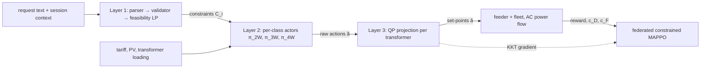

# SOLACE

**Solver-grounded, LLM-Assisted Coordination of Electric vehicles.** This is a research implementation of *"Solver-Grounded, LLM-Orchestrated Multi-Agent Reinforcement Learning for Fair and Degradation-Aware EV Charging and V2G in Weak Distribution Networks with 2W/3W-Dominated Fleets."*

> [!IMPORTANT]
> The manuscript's numerical results are **illustrative targets, not measurements** (stated in its source). This repository implements the method and the experimental protocol. It does **not** reproduce or confirm those numbers, and it ships no pretrained models. Everything runs on synthetic data unless you supply the external datasets. See [IMPLEMENTATION_STATUS.md](IMPLEMENTATION_STATUS.md).

## Why

On Indian distribution networks, short two- and three-wheeler (2W/3W) charging sessions pile onto the residential evening peak, on transformers sized for lighting loads. Multi-agent reinforcement learning (MARL) can coordinate many EVs but cannot take requests written in plain language. Large language model (LLM) schedulers can read such requests, but they produce physically infeasible plans. SOLACE splits authority across three layers:

| Layer | Produces | Never produces |
|---|---|---|
| 1. Intent (LLM) | typed, validated, solver-checked constraints | power set-points |
| 2. Coordination (CTDE MARL) | raw actions per EV | anything sent to hardware |
| 3. Safety (convex projection) | set-points within linearized grid and battery limits | – |

## Key contributions implemented

- Layer 1 pipeline: schema → validator (≤ 2 retries) → default + operator flag → per-EV feasibility LP → counter-offer (`solace.intent`).
- Constrained, federated MAPPO with per-class shared actors, a graph-attention mean-field critic, a Lagrangian treatment of fairness (Jain index) and battery degradation, and FedAvg over 8 aggregators (`solace.training`, Algorithm 1).
- Differentiable safety projection onto LinDistFlow voltage limits and a 16-gon transformer kVA limit. The forward pass is an OSQP solve; gradients come from the KKT conditions (`solace.safety`).
- Weak-feeder environment with a mixed 2W/3W/4W fleet (Table II), AC power-flow verification and a semi-empirical degradation model (`solace.env`, `solace.grid`, `solace.degradation`).
- Baselines: uncontrolled, ToU, Thompson bandits, solver-grounded single agent, perfect-foresight MPC, MAPPO and IPPO, plus six ablation configs.

## Architecture



Details: [docs/architecture.md](docs/architecture.md).

## Repository structure

```text
configs/            default.yaml (paper settings), smoke.yaml, baselines/, ablations/
src/solace/         config, grid, data, degradation, safety, env, agents, training, baselines,
                    evaluation, intent, api, utils
scripts/            preprocess, train, evaluate, infer, intent_corpus, finetune_intent_lora, smoke_test
tests/              unit/, integration/, smoke/
docs/               architecture, setup, training, evaluation, inference, deployment,
                    reproducibility, troubleshooting, assumptions, paper_implementation_mapping
data/               README only (generated data is git-ignored)
```

## Installation

```bash
python -m venv .venv && source .venv/bin/activate      # Windows: .venv\Scripts\activate
pip install torch --index-url https://download.pytorch.org/whl/cpu
pip install -e ".[dev]"
```

Python 3.10–3.13. Optional LLM support: `pip install -e ".[llm]"`. See [docs/setup.md](docs/setup.md).

## Quick start

```bash
python scripts/smoke_test.py          # whole pipeline on a tiny synthetic workload
python -m pytest                      # unit + integration tests
```

## Training

```bash
python scripts/preprocess.py --config configs/smoke.yaml        # data/processed/smoke/
python scripts/train.py --config configs/smoke.yaml --seed 0    # checkpoints/smoke/seed0/final.pt
```

For the full configuration use `configs/default.yaml` (1,000 EVs, 300 rounds; a heavy workload). Baselines and ablations: `configs/baselines/*.yaml`, `configs/ablations/*.yaml`. See [docs/training.md](docs/training.md).

## Evaluation

```bash
python scripts/evaluate.py --config configs/smoke.yaml --checkpoint "checkpoints/smoke/seed{seed}/final.pt"
```

This writes `results/<name>/results.md` and `metrics.json`: peak loading, AC voltage violations, unmet energy, Jain index, cost, degradation cost, intent satisfaction, projection distance and latency, as mean ± 95% CI over test days × seeds. See [docs/evaluation.md](docs/evaluation.md).

## Inference

```bash
python scripts/infer.py intent --text "Need 80% by 7 am, discharge up to 3 kWh but not below 40%" \
  --context '{"vehicle_class":"4W","battery_kwh":40,"soc":0.3,"charger_kw":7.4,"plug_in_time":"20:00","departure_time":"09:00","v2g_capable":true}'
python scripts/infer.py dispatch --config configs/smoke.yaml --checkpoint checkpoints/smoke/seed0/final.pt
uvicorn --factory solace.api.app:create_app --port 8000    # /health, /v1/intent, /v1/dispatch
```

See [docs/inference.md](docs/inference.md) and [docs/deployment.md](docs/deployment.md) (Docker).

## Configuration

YAML files validated by Pydantic (`solace/config.py`). `extends:` inherits from another file. Every value from the paper is tagged `# paper`, and every engineering choice is tagged `# assumption` and explained in [docs/assumptions.md](docs/assumptions.md).

## Datasets

The paper uses ACN-Data, West Bengal irradiance, an unpublished Indian feeder, unpublished 2W/3W session statistics and an unreleased trilingual request corpus. Loaders exist for ACN-Data, irradiance and custom feeders. Defaults are synthetic and labelled as such. See [data/README.md](data/README.md).

## Reproducibility

Seeds, resolved configs, environment metadata and pinned versions make the **software pipeline** reproducible. **Exact scientific reproduction is not possible** with the available materials. [docs/reproducibility.md](docs/reproducibility.md) explains why and gives the full protocol commands.

## Limitations

- Results are not reproduced. The paper reports targets, and this repository has only run tiny smoke workloads.
- Synthetic feeder, loads, PV and sessions. Balanced single-phase LV model. Own AC sweep instead of pandapower.
- Not implemented: MADDPG, QMIX, LLM-only scheduler, "w/o intent layer" ablation, robustness perturbations, IEEE 34-bus data.
- The LLM path (`HFParser`, LoRA fine-tuning) is implemented but has not been executed. The default rule-based parser is a stand-in, not the paper's method.
- Research API only: no authentication or persistent audit log; not for controlling real equipment.

Full list: [IMPLEMENTATION_STATUS.md](IMPLEMENTATION_STATUS.md). Validation evidence: [SMOKE_TEST_REPORT.md](SMOKE_TEST_REPORT.md).

## Citation

```bibtex
@misc{solace2026,
  title  = {Solver-Grounded, {LLM}-Orchestrated Multi-Agent Reinforcement Learning for Fair and
            Degradation-Aware {EV} Charging and {V2G} in Weak Distribution Networks with
            {2W/3W}-Dominated Fleets},
  author = {{SOLACE authors}},
  year   = {2026},
  note   = {Manuscript in preparation; research implementation}
}
```

## License

MIT, see [LICENSE](LICENSE).
