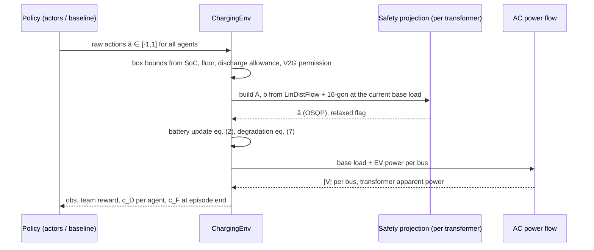
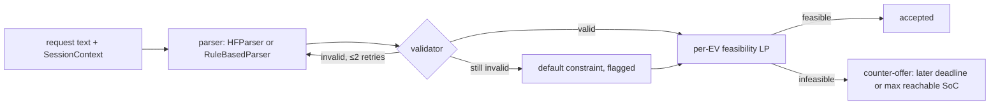

# Architecture

This document describes the code as implemented. For the mapping to the paper see [paper_implementation_mapping.md](paper_implementation_mapping.md).

## Package layout

```text
src/solace/
├── config.py            YAML + Pydantic configuration (extends:, overrides)
├── grid/                feeder model, LinDistFlow (path impedances), AC backward/forward sweep
├── data/                fleet (Table II), sessions + constraints, profiles, scenarios + split
├── degradation.py       eq. (7) cycle + calendar capacity loss and its cost
├── safety/projection.py Layer 3: eq. (11) QP, OSQP solve, KKT Jacobian, torch autograd wrapper
├── env/charging_env.py  constrained Dec-POMDP: bounds, projection, battery, AC check, costs, metrics
├── agents/networks.py   per-class actors, GAT + mean-field critic, concat and local critics
├── training/            rollouts + GAE, constrained MAPPO update, federated loop, checkpoints
├── baselines/           uncontrolled, ToU, bandits, solver-grounded agent, perfect-foresight MPC
├── evaluation/runner.py method registry, evaluation over days × seeds, aggregation, reports
├── intent/              Layer 1: schema, validator, parsers, feasibility LP, pipeline, demo corpus, metrics
├── api/                 FastAPI: /health, /v1/intent, /v1/dispatch
└── utils/               seeding, logging, run directories with metadata
```

## One control step (environment)



## Training (Algorithm 1)

```mermaid
flowchart TD
    A[global θ, φ, λ] --> B[copy to each aggregator m]
    B --> C[joint rollout: each EV acts with its aggregator's actor; Layer 3 in the loop]
    C --> D[per aggregator: GAE for reward, c_F, c_D; Lagrangian advantage]
    D --> E[PPO clip + entropy + β‖Proj(μ)−μ‖² through KKT gradient; value regression]
    E -->|local_iters| C
    E --> F[FedAvg weighted by transitions]
    F --> G[projected dual ascent on λ_F, λ_D]
    G -->|rounds| A
```

## Layer 1 pipeline



## Design choices

- **Arrays, not per-agent dicts.** The environment keeps all agents in fixed-size arrays with an `active` mask. Inactive agents get zero actions and are excluded from losses.
- **Projection per transformer.** Constraints never couple EVs on different transformers, so eq. (11) is solved independently per transformer. This mirrors the paper's deployment, where each aggregator edge server projects the EVs under its transformer.
- **No pandapower / cvxpylayers.** A radial sweep and a KKT active-set Jacobian keep the dependency footprint small. Both are covered by unit tests: LinDistFlow vs AC, and the Jacobian vs finite differences.
- **Learned baselines share the trainer.** MAPPO and IPPO differ from SOLACE only by configuration (`critic_type`, `use_projection`, penalties).

## Complexity notes

- Critic attention is O(Σ_t n_t²) per sample (n_t = EVs on transformer t). For 1,000 EVs over 4 transformers that is ~250² per transformer per step, so large-scale training needs a GPU and small minibatches.
- Every training update solves one projection QP per transformer per sampled step, for the forward pass and for the gradient. This dominates training time at large scale.
- The horizon-QP baselines build O(L²) energy rows per session and re-solve at every step.
